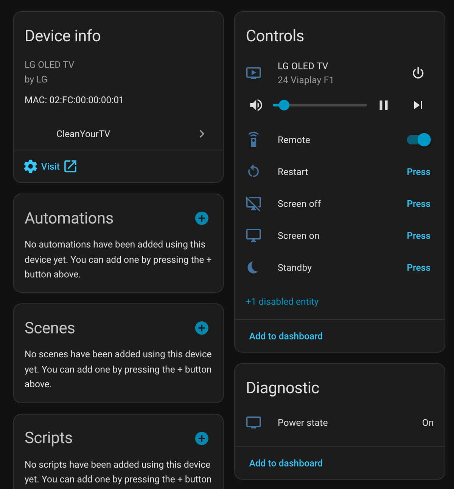
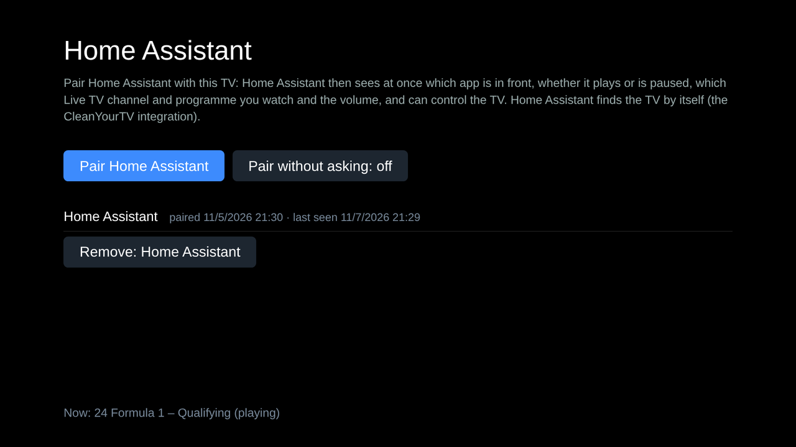
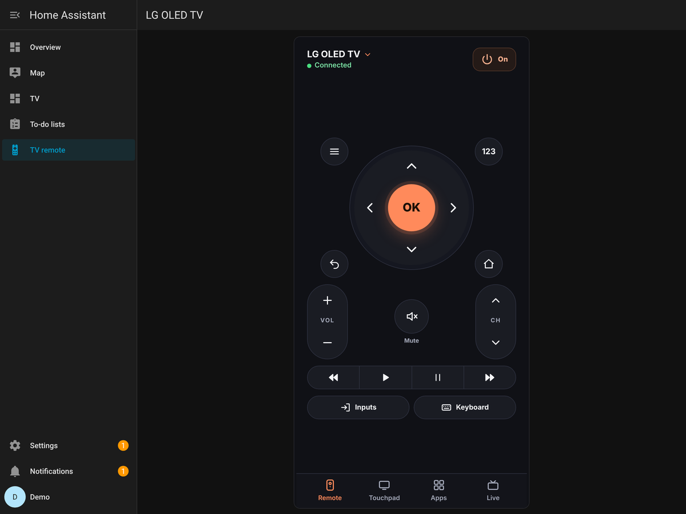
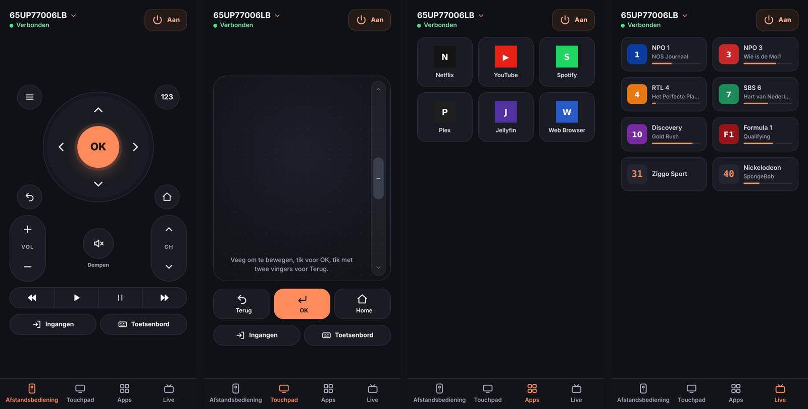

# CleanYourTV for Home Assistant

Your rooted LG webOS TV with [CleanYourTV](https://github.com/lasharor/cleanyourtv-WebOS) in Home Assistant, **both ways**:

- **The TV tells Home Assistant what it is doing**, the moment it changes:
  - which app is in front;
  - whether the video **plays or is paused**, in any app (Netflix, YouTube, Live TV, …);
  - which **Live TV channel** and **programme** you watch;
  - the volume and mute;
  - whether the TV is on, has its screen off, or is in standby.
- **Home Assistant controls the TV:**
  - on, off and the screen;
  - the volume, play and pause, the source and the channel;
  - every remote key, text and the pointer.
- **A remote card** that looks and works exactly like CleanYourTV's Phone remote: buttons, touchpad, apps and Live TV with the guide.


> **Beta.** Everything here was tested on an LG 65UP77006LB (webOS 6.5.3) and with automated tests. Other webOS versions should work, but have not been tested yet. Please [open an issue](https://github.com/larsoss/cleanyourtv-webos-homeassistant/issues) with your TV model, webOS version and what you see.

---

## What you need

| | |
|---|---|
| **TV** | An LG webOS TV that is **rooted** (Homebrew Channel) with **CleanYourTV** installed and running. |
| **Home Assistant** | 2025.1 or newer, with [HACS](https://hacs.xyz). It must be on the same network as the TV. |
| **Network** | Best: a **fixed IP address** for the TV in your router. To turn the TV on from standby, switch on **TV On With Mobile** (Wake-on-LAN) in the TV's settings (search the settings for it; where it is differs per webOS version). |

Something has to run on the TV itself: only a program on the TV can see whether Netflix is paused or which channel plays. That program is the small **Home Assistant add-on** for CleanYourTV. You install it once, on the TV, in step 1. Home Assistant cannot install it for you, because CleanYourTV only accepts installs from the TV itself.

---

## Step 1 — On the TV: install the add-on

**In the CleanYourTV manager app** (on the TV, with the remote):

1. Open **Add-ons** › **Repositories** › **Add from your phone**.
2. Scan the code with your phone. On the phone, type this address:

   ```
   larsoss/cleanyourtv-webos-homeassistant@main/tv-addon
   ```

   Tick that you trust it, and choose **Add**.

   For the beta channel, use `larsoss/cleanyourtv-webos-homeassistant@Beta/tv-addon` instead.
3. Back in **Add-ons**, choose **Home Assistant** and **Install**.

   CleanYourTV first shows what the add-on is allowed to do. Like every add-on that runs on the TV, it runs as root.

**Or over SSH** (`ssh root@<tv-ip>`):

```sh
node /media/developer/cleanyourtv/cytv-addons.js repo-add larsoss/cleanyourtv-webos-homeassistant@main/tv-addon
node /media/developer/cleanyourtv/cytv-addons.js install homeassistant
```

The add-on has its own page on the TV: **Home Assistant**, in the book of pages next to Home. Open it from there, or from **Add-ons** › **Home Assistant**.


---

## Step 2 — In Home Assistant: install and pair

### 2a. Install the integration

1. **HACS** › the three dots › **Custom repositories**. Add `https://github.com/larsoss/cleanyourtv-webos-homeassistant` with type **Integration**.
2. Search for **CleanYourTV** in HACS and **Download** it.

   For the beta channel: on the integration's page in HACS, choose ⋮ › **Redownload**, switch on **Show beta versions**, and pick the newest beta.
3. **Restart Home Assistant.**

### 2b. Add the TV

Home Assistant usually **finds the TV by itself**. **Settings › Devices & services** then shows **"Discovered: CleanYourTV"**. Click **Add**.

If it does not show up: **Settings › Devices & services › Add integration › CleanYourTV**, and type the TV's IP address.

### 2c. Pair (no code to type)

It works like the button of a Hue bridge:

1. **On the TV**, open the add-on's page **Home Assistant** and choose **Pair Home Assistant**. The TV now waits for three minutes.
2. **In Home Assistant**, click **Submit**.


That's it. The TV appears as a device with a media player, a remote, buttons and a power-state sensor. **Visit** opens its remote:



The add-on's page on the TV shows the paired Home Assistants and can remove one:



---

## Step 3 — The remote

The integration brings the remote along. You do not have to install it separately or add it as a resource. There are three ways to open it.

**1. In the sidebar: "TV remote".** Right after pairing, a page with the remote appears in the sidebar. With several TVs, choose one at the top.

**2. From the TV's device page: "Visit".** It opens that TV's remote page. You can switch the sidebar entry off in the integration's settings; this link stays.



**3. On a dashboard of your choice, with one click:**

1. Go to **Settings › Devices & services › CleanYourTV** and open the **cogwheel** (Configure).
2. Choose **Put the remote on a dashboard** and pick the dashboard.

A new view **"TV remote"** is added to that dashboard, with the media player and the remote. Nothing else on the dashboard changes.

This works for dashboards made in the UI. The automatic Overview can only be changed once you have taken control of it.

**Or add the card yourself:** **Edit dashboard › Add card › "CleanYourTV remote"**, or in YAML:

```yaml
type: custom:cleanyourtv-remote
entity: media_player.lg_tv
height: 720
```

For `entity`, use **your** TV's media player: the one made by CleanYourTV, not the one of LG's own webOS integration.


It is the Phone remote of CleanYourTV, by [@Edenik](https://github.com/Edenik):

- the round pad with OK, VOL and CH, mute, the play bar, Inputs, Keyboard, 123 (numbers and colours) and power;
- the **Touchpad** moves the TV's pointer;
- **Apps** opens an app;
- **Live** lists your Live TV channels with the programme that is on now.

The card follows Home Assistant's language. Every language of CleanYourTV is included:



---

## What you get in Home Assistant

### Media player

| State | When |
|---|---|
| `playing` / `paused` | the video in front plays or is paused (any app that plays through the TV) |
| `buffering` | a video is loading |
| `on` | on, nothing plays |
| `idle` | the screen is off, the TV runs |
| `off` | standby, or not reachable |

**During Live TV:**

- `media_channel` is the channel, for example `24 Formula 1`;
- `media_title` is the programme from the guide;
- `media_duration` and `media_position` follow the programme;
- the picture is the channel logo.

**Attributes:**

- `app_id` and `app_name`;
- `live_channel_number`, `live_channel_name`, `live_channel_group`;
- `programme_title`, `programme_start`, `programme_end`, `programme_description`;
- `next_programme_title`, `next_programme_start`;
- `power_state`, `sound_output`, `connected`.

**What it controls:**

- **turn on:** Wake-on-LAN, or the screen back on;
- **turn off:** standby;
- **volume:** set, up and down, mute;
- **play, pause, stop;**
- **next and previous:** channel up and down;
- **source:** inputs and apps, and the Live TV channels if you switch that on in the integration's options;
- **`play_media`:** `media_content_type: app` with an app id, or `channel` with a number.

### Remote, buttons and sensor

- **Remote** (`remote.*`) — `remote.send_command` takes the TV's key names:

  ```
  UP DOWN LEFT RIGHT ENTER BACK HOME MENU EXIT INFO POWER VOLUMEUP VOLUMEDOWN MUTE CHANNELUP CHANNELDOWN PLAY PAUSE STOP REWIND FASTFORWARD RED GREEN YELLOW BLUE 0-9
  ```

  It also takes `text:<text>`, `enter`, `delete`, `click`, `launch:<app id>` and `live:<number>`. Its attributes list the app ids.
- **Buttons:** Screen off, Screen on, Standby, Restart, and Shut down. Shut down is disabled by default, because only the TV's own remote turns the TV back on after it.
- **Sensor:** the power state (On, Screen off, Standby, Not reachable, …).
- **Actions:** `cleanyourtv.send_text`, `cleanyourtv.launch_app`, `cleanyourtv.live_channel`, `cleanyourtv.tv_power`, `cleanyourtv.pointer` and `cleanyourtv.refresh_lists`.

### Example automations

Lights up a little when Netflix is paused:

```yaml
alias: TV paused, lights up
triggers:
  - trigger: state
    entity_id: media_player.lg_tv
    to: paused
conditions:
  - condition: state
    entity_id: media_player.lg_tv
    attribute: app_id
    state: netflix
actions:
  - action: light.turn_on
    target:
      entity_id: light.living_room
    data:
      brightness_pct: 60
mode: single
```

A message when you switch to a channel:

```yaml
alias: Formula 1 is on
triggers:
  - trigger: state
    entity_id: media_player.lg_tv
    attribute: live_channel_number
    to: 24
actions:
  - action: notify.notify
    data:
      message: "On TV now: {{ state_attr('media_player.lg_tv', 'programme_title') }}"
mode: single
```

---

## Troubleshooting

| What you see | What to do |
|---|---|
| **"The TV did not answer"** when adding | Is the TV on? Is the **Home Assistant** add-on installed and switched on (manager › Add-ons)? Is the IP address right, and is the port `8801`? |
| **"The TV is not waiting"** | Choose **Pair Home Assistant** on the add-on's page on the TV first, then click Submit within three minutes. |
| **"Custom element doesn't exist: cleanyourtv-remote"** | Home Assistant has not loaded the card yet. Restart Home Assistant once after installing. In the **Companion app**, close it completely and open it again, or use Settings › Companion app › Troubleshooting › reset the frontend cache. |
| **Home Assistant asks to pair again** | The TV removed this Home Assistant (on the add-on's page). Pair again as in step 2c. |
| **Turning on does not work** | Switch on **TV On With Mobile** in the TV's settings, and give the TV a fixed IP address. The first time, turn the TV on with its own remote while Home Assistant is connected, so that it learns the TV's MAC address. |
| **The first remote key asks something on the TV** | The TV asks once whether the add-on may use its pointer. Allow it. |
| **An app shows no play/pause** | Not every app plays through the TV's own media pipeline. Please open an issue with the app's name. |

## Versions

- **`main`** is the release.
- **`Beta`** gets new things first:
  - the integration's beta versions end in `b1`, `b2`, … (for example `0.2.0b3`);
  - the TV add-on's name says "(beta)".
- **In HACS**, switch on **Show beta versions** to follow the beta channel. HACS then only offers an update for a new beta or a new release.

## Privacy and security

- **Your network only.** Everything stays on your own network: the TV and Home Assistant talk directly, on port 8801. The connection is plain HTTP, so use it on a network you trust.
- **Pairing.** Only a Home Assistant that was paired while you chose **Pair Home Assistant** on the TV can use it. Every call needs that pairing's token. Web pages in a browser are refused.
- **Pair without asking.** On the add-on's page, **Pair without asking** lets any Home Assistant on your network pair without the step on the TV. It is off by default, and not recommended.
- **Your IPTV address.** The address of your IPTV stream (it can contain your provider's login) never leaves the TV. Home Assistant only gets the channel's number, name, group, programme and logo.

## How it works

| Part | Where | What |
|---|---|---|
| **TV add-on "Home Assistant"** | `tv-addon/` (a CleanYourTV add-on repository) | Runs inside CleanYourTV on the TV. It follows LG's own services while Home Assistant is connected: the app manager, `com.webos.media` (play state), audio and power. It matches the Live TV stream against your playlist and the guide, and answers on port 8801. |
| **Integration "CleanYourTV"** | `custom_components/cleanyourtv` (HACS) | Finds the TV (LG's SSDP announcement), pairs once, then keeps a long poll open, so the TV answers the moment something changes. It also serves the remote card. |

## Development

```sh
pip install -r requirements_test.txt
python -m pytest tests                                             # the integration against the add-on with a fake TV (needs node)
node tv-addon/make-index.js                                        # after every change of the add-on (and raise its version)
CYTV_SRC=/path/to/cleanyourtv-WebOS node tests/addon_manifest.test.js
CYTV_SRC=/path/to/cleanyourtv-WebOS node tools/build-card.js       # the card's pages, from the Phone remote's page
```

The add-on runs on Node.js 8.12 (webOS 5 and 6).

**Credits:**

- [CleanYourTV](https://github.com/lasharor/cleanyourtv-WebOS) by Stefan (lasharor).
- The Phone remote by [@Edenik](https://github.com/Edenik). Its page is the remote card, and its key code (`remotekeys.js`, `ws.js`) is used by the add-on. MIT.
