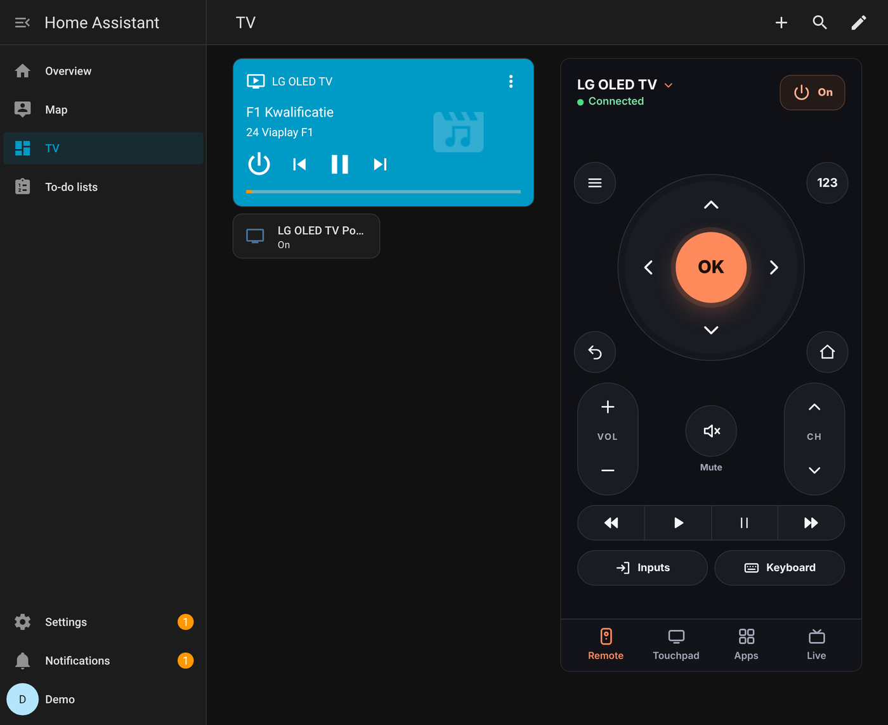
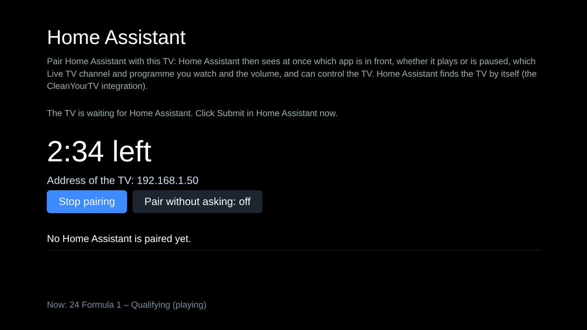
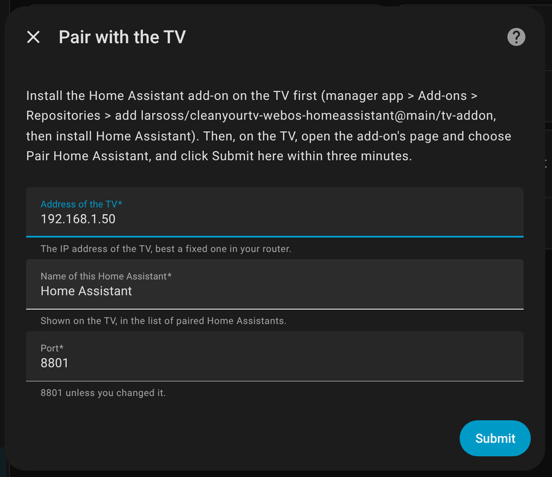
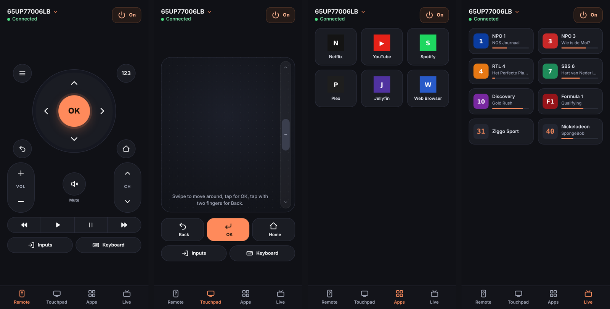

# CleanYourTV for Home Assistant

Control a rooted LG webOS TV that runs [CleanYourTV](https://github.com/lasharor/cleanyourtv-WebOS) from Home Assistant. It works both ways: the TV reports what it is doing the moment it changes, and Home Assistant controls the TV.



**What the TV reports:**

- the app in front;
- whether it is **playing or paused** (Netflix, YouTube, Live TV, …);
- the **Live TV channel and programme**;
- the volume and mute;
- whether it is on, has the screen off, or is in standby.

**What Home Assistant can do:**

- turn the TV on and off, and the screen on and off;
- set the volume, play and pause;
- pick the source or a channel;
- send any key or text;
- show the **CleanYourTV Phone remote** as a card.

## Before you start

- **The TV:** an LG webOS TV, rooted, with CleanYourTV installed.
- **Home Assistant:** on the same network as the TV, and either:
  - 2026.11 or newer, which has the built-in **Marketplace**;
  - 2025.1 or newer with [HACS](https://hacs.xyz).
- **Recommended:**
  - give the TV a fixed IP address in your router;
  - switch on **TV On With Mobile** in the TV's settings, so Home Assistant can turn it on.

## Install

### 1. On the TV: the add-on

The add-on is what tells Home Assistant what the TV is doing, so it is needed.

1. In the CleanYourTV manager app, go to **Add-ons › Repositories › Add from your phone**.
2. On the phone, enter `larsoss/cleanyourtv-webos-homeassistant@main/tv-addon`.
3. In **Add-ons**, choose **Home Assistant › Install**.

<details><summary>Over SSH instead</summary>

```sh
node /media/developer/cleanyourtv/cytv-addons.js repo-add larsoss/cleanyourtv-webos-homeassistant@main/tv-addon
node /media/developer/cleanyourtv/cytv-addons.js install homeassistant
```

</details>

### 2. In Home Assistant: the integration

**Home Assistant 2026.11 and newer (Marketplace):**

1. Go to **Settings › Marketplace › Add from link** and enter `larsoss/cleanyourtv-webos-homeassistant`.

   The first time, the Marketplace asks you to connect GitHub. That connection is read-only.
2. Open **CleanYourTV** and choose **Install**.

   No restart is needed: setup starts right away, so continue with step 3.

**Older Home Assistant (HACS):**

1. Go to **HACS › ⋮ › Custom repositories** and add `https://github.com/larsoss/cleanyourtv-webos-homeassistant` as an **Integration**.
2. **Download** it and **restart Home Assistant**.

### 3. Pair, without a code

1. Home Assistant finds the TV by itself: **Settings › Devices & services** shows **CleanYourTV**. Click **Add**.

   If it does not show up, choose **Add integration › CleanYourTV** and enter the TV's IP address. With the Marketplace, the setup it starts after installing asks for the address the same way.
2. On the TV, open the add-on's page **Home Assistant** (in the book next to Home) and choose **Pair Home Assistant**.
3. In Home Assistant, click **Submit** within three minutes.

| On the TV | In Home Assistant |
|---|---|
|  |  |

## The remote



The remote comes with the integration, so there is nothing extra to install. You can open it in three ways:

- **Sidebar:** **TV remote**. The ✕ at the top right takes you back.
- **The TV's device page:** **Visit**.
- **On a dashboard:** go to **Settings › Devices & services › CleanYourTV › ⚙️ › Put the remote on a dashboard**. This adds a view with the remote to the dashboard you choose.

You can also add it as a card yourself:

```yaml
type: custom:cleanyourtv-remote
entity: media_player.lg_tv   # the CleanYourTV media player, not the LG webOS one
height: 720
close: auto   # a ✕ to close it: auto = only in a popup (browser_mod, Bubble Card, …), true = always, false = never
```

## What you get

| Entity | What it does |
|---|---|
| **Media player** | State `playing` / `paused` / `on` / `idle` (screen off) / `off`. During Live TV, `media_channel` is the channel and `media_title` is the programme, with a progress bar and the channel logo. Volume, mute, play/pause, channel up/down, and source. |
| **Remote** | `remote.send_command` with key names (`UP`, `ENTER`, `HOME`, `VOLUMEUP`, `RED`, `1`, …) and `text:…`, `launch:<app id>`, `live:<number>`. |
| **Buttons** | Screen off, screen on, standby, restart, shut down (disabled by default). |
| **Sensor** | The power state. |

**Useful attributes** on the media player:

- `app_id`;
- `live_channel_number`, `live_channel_name`;
- `programme_title`, `programme_end`;
- `next_programme_title`.

**Example:** lights up when Netflix is paused.

```yaml
alias: Netflix paused, lights up
triggers:
  - trigger: state
    entity_id: media_player.lg_tv
    to: paused
conditions:
  - condition: state
    entity_id: media_player.lg_tv
    attribute: app_id
    state: netflix
actions:
  - action: light.turn_on
    target:
      entity_id: light.living_room
    data:
      brightness_pct: 60
mode: single
```

## Problems?

| You see | Do this |
|---|---|
| "The TV did not answer" | The TV is on? The **Home Assistant** add-on is installed? Port `8801`? |
| "The TV is not waiting" | First choose **Pair Home Assistant** on the TV, then **Submit**. |
| "Custom element doesn't exist: cleanyourtv-remote" | Reload the page. In the Companion app, close the app fully and open it again. After an **update**, restart Home Assistant first: the Marketplace shows a repair for this. |
| Home Assistant asks to pair again | The TV removed it. Pair again (step 3). |
| Turning on does nothing | Switch on **TV On With Mobile** on the TV. Turn the TV on once with its own remote while Home Assistant is connected. |
| The TV asks something at the first key press | Allow it: the add-on needs the TV's pointer for the keys. |

Still stuck? [Open an issue](https://github.com/larsoss/cleanyourtv-webos-homeassistant/issues) with your TV model and webOS version.

## Good to know

- **Beta versions:**
  - **Marketplace:** go to **Settings › Devices & services › Marketplace** and open **CleanYourTV**. Enable the **Pre-release** entity (it is disabled by default) and switch it on.
  - **HACS:** switch on **Show beta versions**.
  - **On the TV:** use `…@Beta/tv-addon` as the repository address.
- **Updates** appear under **Settings › Updates**. After an update, restart Home Assistant.
- **Privacy:** everything stays on your network.
  - Only a Home Assistant you paired on the TV can use the add-on.
  - Your IPTV stream address (which can hold your provider's login) never leaves the TV.
- **Tested on:** LG 65UP77006LB, webOS 6.5.3. Other webOS versions should work, but have not been tested yet.

## Development

```sh
pip install -r requirements_test.txt && python -m pytest tests             # needs node
node tv-addon/make-index.js                                                # after changing the add-on
CYTV_SRC=/path/to/cleanyourtv-WebOS node tools/build-card.js               # rebuild the remote card
```

**Credits:**

- [CleanYourTV](https://github.com/lasharor/cleanyourtv-WebOS) by Stefan (lasharor).
- The Phone remote, which the remote card and the add-on's keys are built on, by [@Edenik](https://github.com/Edenik) (MIT).
